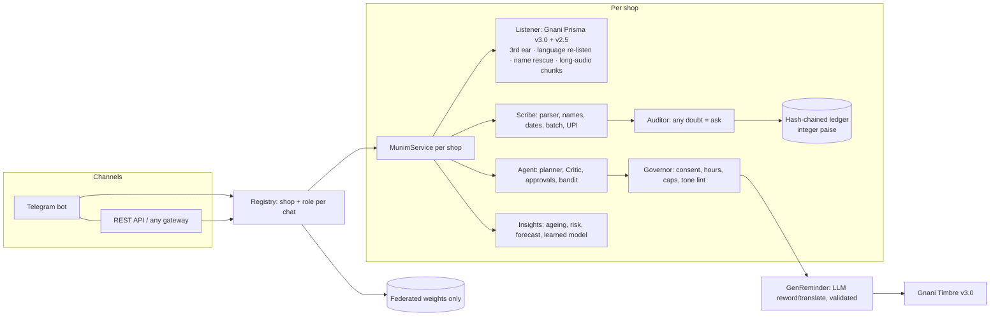

# Architecture

**Layers and the rule each enforces**
| Layer | Rule |
|---|---|
| Transport (Telegram / REST) | Thin. Deny-by-default role check (`tenancy/roles.py`); no business logic. |
| Service | One conversation brain; every write passes the Auditor; batch/import/UPI need one human confirm. |
| Ledger | Append-only, SHA-256 chained, integer paise, reversal-based undo, pseudonymous refs, per-shop HMAC secret. |
| AI components | May *propose* (spans, tool choice, reworded text, handwriting transcription). Code computes every amount; anything the model returns is validated, and failure falls back to a deterministic path. |
| Customer-facing output | Always a draft (reminder, statement, pay link) that the owner approves; opt-out/dispute act instantly; AI sender disclosed. |

**Where Gnani is used** (all via one client: one request in flight, priority queue, retry rules, credit meter)
Prisma v3.0 (primary ear, keyterms from customer names, `previous_text` chaining, language detection → re-listen),
Prisma v2.5 (independent second ear), Prisma `format=codemix` (3rd ear on amount disagreement), `format=transliterate`
(name rescue), Timbre v3.0 (13 voices; hi-en / en-IN / Indic language codes; amounts spoken as words; speed per message).
Per-shop daily call quota inside a global budget so one shop cannot starve the rest.
